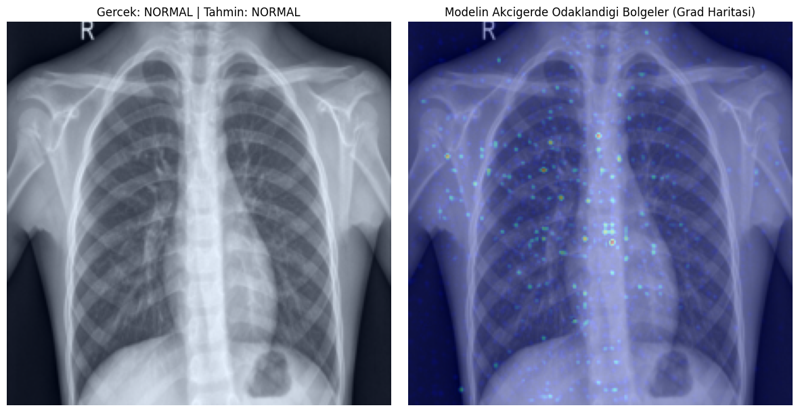

# Medical Image Diagnosis with Explainable AI

Pneumonia detection from chest X-rays using transfer learning (ResNet50) in PyTorch, with gradient-based visual explanations that show which image regions drive the model's prediction.

> **Disclaimer:** This is an educational project. It is **not** a medical device and must not be used for clinical decisions.

## Overview

| | |
|---|---|
| **Task** | Binary image classification: `NORMAL` vs `PNEUMONIA` |
| **Dataset** | [Chest X-Ray Images (Pneumonia)](https://www.kaggle.com/datasets/paultimothymooney/chest-xray-pneumonia) (Kaggle) |
| **Model** | ResNet50 pretrained on ImageNet, frozen backbone, custom classification head |
| **Imbalance handling** | Class-weighted cross-entropy loss |
| **Explainability** | Gradient saliency maps (notebook) and Grad-CAM (`src/explain.py`) |
| **Framework** | PyTorch, torchvision, OpenCV |

## Method

1. **Preprocessing:** resize to 224x224, ImageNet normalization. Training augmentation: random rotation (±15°) and horizontal flip. No augmentation on validation/test data.
2. **Class imbalance:** the training set (5,216 images) has far more pneumonia than normal cases, so the loss uses weights `N / (num_classes * N_c)`: **1.94** for NORMAL and **0.67** for PNEUMONIA.
3. **Model:** ResNet50 with all backbone layers frozen. The final layer is replaced by `Linear(2048, 256) → ReLU → Dropout(0.4) → Linear(256, 2)`. Only this head is trained (Adam, lr = 1e-3, batch size 32, 10 epochs).
4. **Explainability:** the gradient of the predicted class score with respect to the input image is computed and shown as a heatmap overlay, to inspect which pixels influence the decision.

## Results

Evaluated on the held-out test set (624 images: 234 NORMAL, 390 PNEUMONIA), model trained for 10 epochs:

| Epochs | Test Acc | PNEUMONIA Recall | PNEUMONIA Precision | NORMAL Recall | ROC-AUC |
|:---:|:---:|:---:|:---:|:---:|:---:|
| 10 | 87.98% | 0.946 | 0.872 | 0.769 | 0.950 |

| Class | Precision | Recall | F1 | Support |
|---|:---:|:---:|:---:|:---:|
| NORMAL | 0.896 | 0.769 | 0.828 | 234 |
| PNEUMONIA | 0.872 | 0.946 | 0.908 | 390 |

- The model catches most pneumonia cases (recall 0.946), which matters most in a screening setting, but it also flags a considerable share of healthy X-rays as pneumonia (NORMAL recall 0.769).
- Final training epoch: loss 0.1163, accuracy 95.53% (on augmented training data). The gap to the 87.98% test accuracy shows the model does not generalize perfectly to the test split.

### Explainability example



*Left: input X-ray (true: NORMAL, predicted: NORMAL). Right: gradient saliency overlay.*

Note that plain gradient saliency maps are typically noisy and pixel-level. Grad-CAM (available in `src/explain.py`) produces smoother, region-level heatmaps and is usually easier to interpret.

## Project structure

```
medical-image-diagnosis-xai/
├── README.md
├── LICENSE
├── requirements.txt
├── .gitignore
├── notebooks/
│   └── medical-image-diagnosis-with-explainable-ai.ipynb   # original Kaggle notebook
├── src/
│   ├── config.py      # hyperparameters, paths, device
│   ├── data.py        # transforms, datasets, dataloaders, class weights
│   ├── model.py       # ResNet50 + custom head
│   ├── train.py       # training loop, saves checkpoint
│   ├── evaluate.py    # test metrics + confusion matrix
│   └── explain.py     # gradient saliency + Grad-CAM
├── assets/            # images used in the README
└── data/              # dataset goes here (git-ignored)
```

## Getting started

```bash
git clone https://github.com/<Mert30>/medical-image-diagnosis-xai.git
cd medical-image-diagnosis-xai
python -m venv .venv && source .venv/bin/activate
pip install -r requirements.txt
```

**Dataset:** download it from [Kaggle](https://www.kaggle.com/datasets/paultimothymooney/chest-xray-pneumonia) and place it so the folder looks like `data/chest_xray/{train,val,test}/{NORMAL,PNEUMONIA}/`. Or point to it with `export DATA_DIR=/path/to/chest_xray`.

```bash
python -m src.train       # train the classification head, saves results/resnet50_pneumonia.pth
python -m src.evaluate    # test accuracy, classification report, confusion matrix
python -m src.explain     # saliency + Grad-CAM figure -> results/explanations.png
```

Or run the original notebook directly on Kaggle: `notebooks/medical-image-diagnosis-with-explainable-ai.ipynb`.

## Limitations and future work

- Only the classification head is trained (10 epochs). Fine-tuning deeper layers could improve results, especially the low recall on NORMAL images (many false positives).
- Training accuracy (95.53%) is noticeably higher than test accuracy (87.98%). Stronger regularization or augmentation, and a proper validation split for tuning, may help close the gap.
- The Kaggle validation split is very small, so it is not a reliable signal for model selection. A larger validation split carved from the training data would be better.
- Explanations are qualitative. They should be checked against radiologist annotations before drawing conclusions about what the model "looks at".
- Single dataset from one source; generalization to other hospitals or scanners is untested.

## License

MIT, see [LICENSE](LICENSE).
